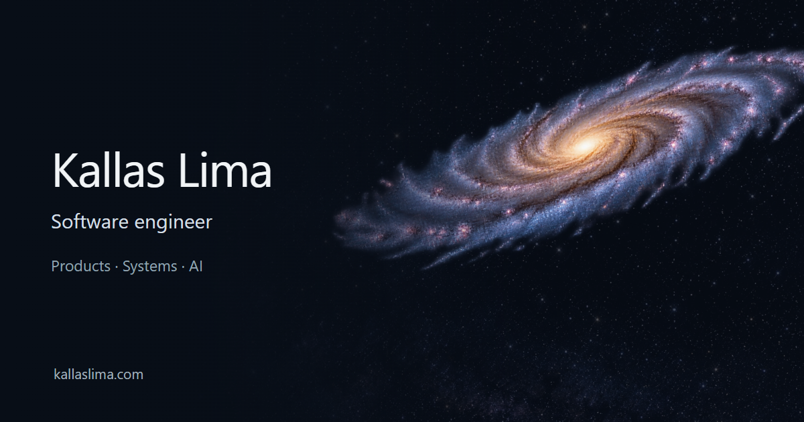

# Kallas Lima

I'm a software engineer based in Belo Horizonte, Brazil, with experience as a Staff Engineer and Engineering Manager.

I work across backend services, web and mobile applications, infrastructure and production AI. I like to understand who uses a product and what needs to change before choosing the technology, and stay involved from architecture and implementation through delivery and operation.

**[Portfolio](https://kallaslima.com)** · [LinkedIn](https://www.linkedin.com/in/kallas-lima/)

## Selected work

| Project | What I worked on |
| --- | --- |
| [Capacity Planner](https://github.com/KallasLima/capacity-planner) | Recurring capacity planning, conflict-aware edits and atomic scenario changes across a Go/PostgreSQL API and a React interface. |
| [Creative Workflow Studio](https://github.com/KallasLima/creative-workflow-studio) | A Figma plugin and backend prototype for copy, localization and image-job workflows, with persisted usage and audit records. Model outputs are demo fixtures. |
| [My website](https://github.com/KallasLima/portfolio-website-source) | An interactive 3D portfolio with chapter navigation, progressive loading and browser-performance work. |

## More work

- **[Weather & Air](https://github.com/KallasLima/weather-and-air)**: React Native place search with explicit location selection, weather and air-quality integrations, cancellation and partial-failure handling.
- **[The Mixing Book](https://github.com/KallasLima/cocktail-recipes)**: A Flutter recipe browser with ingredient search, category filters and complete preparation pages.
- **[Service Refactoring Notes](https://github.com/KallasLima/service-refactoring-notes)**: My case study on password migration, bounded SQL enrichment, error contracts and test isolation in an existing Python service.
